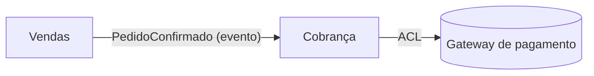

# Context map

Bounded contexts do produto e como se relacionam. Cada contexto é uma pasta
`apps/api/src/modules/<contexto>/` e tem um arquivo em `contexts/`.

| Contexto | Propósito | Relação | Com |
|---|---|---|---|
| <!-- vendas --> | <!-- carrinho, pedido --> | <!-- cliente/fornecedor --> | <!-- cobranca --> |

Tipos de relação: cliente/fornecedor, conformista, camada anticorrupção (ACL),
shared kernel, publicação de eventos.
